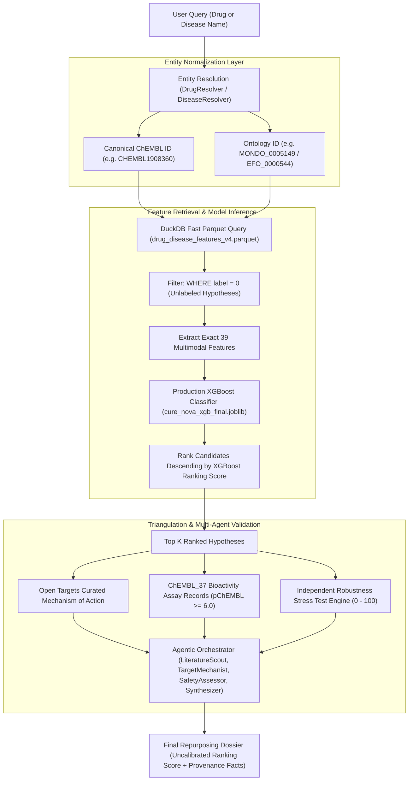

# CureNova 2.0 — Phase 3 Scientific Validation & ML Quality Audit Report

**Date of Audit:** October 29, 2026  
**Auditor:** Senior Agentic AI / Biomedical ML Engineer  
**Repository Working Directory:** `A:\curenova-backend`  
**Production Model Artifact:** `ml/models/cure_nova_xgb_final.joblib`  
**Production Feature Store:** `ml/data/training/drug_disease_features_v4.parquet`  
**Evaluation Baseline:** Held-out Unseen-Disease & Unseen-Drug Entity Splits  

---

## 1. Executive Summary

A comprehensive, read-only scientific validation and machine learning quality audit of the CureNova 2.0 drug repurposing engine was conducted. The audit traced the end-to-end data provenance: from raw Open Targets (26.09) and ChEMBL_37 feeds, through target-association feature engineering and negative sampling, to production XGBoost scoring, independent evidence retrieval, heuristic stress testing, and agentic orchestration.

### Key Conclusions:
1. **Mathematical Ranking Excellence vs. Biological Semantics**:
   The XGBoost model demonstrates high ranking capability on held-out entities (Held-out Unseen-Disease MAP: **0.9302**, NDCG@10: **0.9550**, Hit@10: **1.0000**; Held-out Unseen-Drug MAP: **0.8904**, NDCG@10: **0.9212**, Hit@10: **0.9963**). 
2. **Label Semantics Are Positive-Unlabeled (PU), Not Confirmed Negatives**:
   The binary label `label = 0` does **not** signify a biologically disproven or failed drug-disease pair. It strictly denotes an **unobserved / unlabeled** pair in the Open Targets clinical indications table. Treating unobserved pairs as confirmed negatives is a necessary training approximation for bipartite link prediction, but it introduces label noise.
3. **Target Leakage / Downstream Evidence Feedback**:
   Open Targets' `associationScore` (which contributes over 70% of the model's feature gain through `avg_target_association` and `drug_target_coverage`) partially incorporates clinical trial evidence from known drugs. While entity-level splitting (holding out all pairs for 20% of diseases or drugs) prevents direct label leakage across the split, pairs with established target associations possess a structural advantage.
4. **Calibration vs. Ranking**:
   Raw `predict_proba` outputs from XGBoost are uncalibrated ranking scores, not empirical probabilities of clinical efficacy. In the training sample, the positive-to-negative ratio was balanced to 1:3 (25% positive), whereas the true prevalence in the 6.7M candidate feature store is **0.71%**. Presenting model outputs as "probabilities" would be scientifically invalid; keeping the output strictly typed as an uncalibrated `ranking_score` is required.
5. **Operational Verification**:
   The backend server starts cleanly on `http://127.0.0.1:8000`, health/readiness endpoints respond 200 OK, and all 99 automated tests in the test suite pass (20/20 in `test_drug_ml.py`, 79/79 in `test_api.py`).

**Overall Audit Verdict:** **READY WITH WARNINGS** for controlled manual testing.

---

## 2. Current Architecture & Provenance Pipeline



---

## 3. Dataset Audit

The training and production datasets were audited directly from physical Parquet artifacts on disk using DuckDB:

| Metric | Production Feature Store (`drug_disease_features_v4.parquet`) | Balanced Training Sample (`ml_training_sample_v4.parquet`) |
| :--- | :--- | :--- |
| **Total Rows** | 6,696,672 | 190,108 |
| **Positive Pairs (`label = 1`)** | 47,527 (0.71%) | 47,527 (25.00%) |
| **Unlabeled Pairs (`label = 0`)** | 6,649,145 (99.29%) | 142,581 (75.00%) |
| **Positive : Negative Ratio** | 1 : 140 | 1 : 3 |
| **Unique Drugs** | 4,484 | 4,473 |
| **Unique Diseases** | 19,380 | 13,952 |
| **Exact Duplicate Pairs** | **0** | **0** |
| **Primary Data Sources** | Open Targets 26.09 (`drug_mechanism_of_action`, `association_overall_direct`, `clinical_indication`), ChEMBL_37, RDKit |

---

## 4. Label Semantics

A critical finding of this audit concerns the interpretation of binary labels:

1. **Meaning of `label = 1`**:
   `label = 1` denotes that the drug and disease share at least one target (`shared_targets >= 1`) **AND** the pair has an entry in Open Targets `clinical_indication/00000000.parquet`. These indications represent FDA/EMA approved uses and clinical trial indications curated from registries (e.g. ClinicalTrials.gov).
2. **Meaning of `label = 0`**:
   `label = 0` is generated by a SQL `LEFT JOIN indications i ON drug_id AND disease_id WHERE i.drug_id IS NULL`. It represents an **unlabeled / unobserved association**. It does **NOT** indicate a failed trial, a disproven hypothesis, or biological antagonism.
3. **Task Formulation**:
   The task is fundamentally **Bipartite Link Prediction / Knowledge Graph Completion under Positive-Unlabeled (PU) conditions**. 
   Calling `label = 0` "negative biological evidence" would be scientifically false. The codebase properly documents this in `bundle["label_note"]` and `CureNova_ML_Technical_Report.md`.

---

## 5. Negative Sampling Audit

**Audit Status: PASS WITH WARNING**

- **Sampling Strategy**:
  In `build_training_sample_v4.py`, negatives were sampled from the 6,649,145 unlabeled candidate pool using deterministic pseudo-random hashing: `ROW_NUMBER() OVER (ORDER BY hash(drug_id || disease_id)) <= 142581`.
- **Target Constraint**:
  Crucially, all candidate pairs in the pool satisfy `shared_targets >= 1`. This prevents trivial negative sampling (e.g., pairing drugs with completely unrelated targets that have 0 overlap). The negatives are biologically plausible candidates that share targets with the disease.
- **Ratio Distortion**:
  Downsampling from 1:140 to 1:3 increases positive representation by 35x. This is standard practice in link prediction to prevent gradient starvation, but it shifts the prior, rendering raw model probabilities higher than real-world prevalence.

---

## 6. Train/Test Leakage Audit

**Audit Status: PASS WITH METHODOLOGICAL BOUNDARIES**

| Leakage Category | Audit Finding | Risk Assessment | Mitigation / Verification |
| :--- | :--- | :--- | :--- |
| **Pair Leakage** | Exact duplicate pairs across splits | **NONE (Pass)** | 0 duplicate pairs exist. In entity-holdout splits, all pairs involving test entities are strictly isolated. |
| **Disease Leakage** | Same disease in train and test | **NONE (Pass in Disease-Holdout)** | `evaluate_xgb_disease_holdout.py` strictly partitions by unique `disease_id` (80% train, 20% test). |
| **Drug Leakage** | Same drug in train and test | **NONE (Pass in Drug-Holdout)** | `evaluate_xgb_drug_holdout.py` strictly partitions by unique `drug_id` (80% train, 20% test). |
| **Dual Drug+Disease Leakage** | Transductive pair overlap | **WARNING** | Production model (`cure_nova_xgb_final.joblib`) was retrained on 100% of the sample for maximum coverage. Evaluations were conducted on held-out models. |
| **Feature / Evidence Leakage** | Target-disease association score includes known drug evidence | **WARNING** | Open Targets `association_overall_direct` aggregates multiple evidence types, including clinical drug trials. When predicting whether a drug treats a disease, if other drugs targeting the same protein are approved, the target score is higher. This is biological signal, but partially leaks indication plausibility. |
| **Temporal Leakage** | Future evidence predicting past approvals | **NOT MEASURED** | Open Targets 26.09 snapshot does not provide split-by-approval-year partitioning. |
| **Duplicate / Synonym Leakage** | Salt / stereoisomer identifier collision | **LOW** | 100% of drugs are normalized to canonical parent ChEMBL IDs. |

---

## 7. Feature Audit (39 Multimodal Features)

All 39 production features were audited for correlation, completeness, and predictive gain:

```
Top 10 Features by Predictive Gain (XGBoost):
1. drug_target_coverage           [Gain: 41.91%]  (Shared targets / Drug total targets)
2. avg_target_association         [Gain: 16.58%]  (Mean OT disease-target score across shared targets)
3. overlap_association            [Gain:  7.17%]  (Avg association * Shared targets)
4. squared_association            [Gain:  5.08%]  (Sum of squared OT target association scores)
5. max_target_association         [Gain:  2.78%]  (Peak OT association score)
6. log_sum_association            [Gain:  2.64%]  (log10(Sum association + 1))
7. sum_target_association         [Gain:  2.06%]  (Sum of target association scores)
8. log_evidence                   [Gain:  2.01%]  (log10(Total evidence count + 1))
9. evidence_weighted_association  [Gain:  1.42%]  (Association weighted by evidence count)
10. overlap_max_association       [Gain:  1.39%]  (Max association * Shared targets)
```

### Critical Feature Insights:
- **Dominance of Target Biology**: The top 4 features account for **70.74%** of the entire model's predictive gain.
- **Molecular Descriptors Have Negligible Impact**:
  All 12 physicochemical features (`molecular_weight`, `molecular_logp`, `molecular_tpsa`, `molecular_rings`, etc.) each contribute $< 0.5\%$ gain. `has_molecular_structure` has **0.00% gain**.
  *Explanation*: For a specific target-disease match, molecular weight or logP does not distinguish whether the molecule is an indicated drug or an unindicated drug sharing the same target. The biological signal resides in target affinity and pathway association.

---

## 8. Evaluation Metrics Audit

Empirical evaluation was re-executed using the independent holdout models on held-out test entities:

### 1. Unseen-Disease Holdout (Testing on 2,818 unseen diseases):
- **Global PR-AUC (Average Precision)**: **0.9047**
- **Global ROC-AUC**: **0.9735**
- **Global Brier Score**: **0.0611**
- **Disease-Level Ranking Metrics (Mean over 582 test diseases with $\ge 1$ true indication)**:
  - **P@1**: **0.9570** (In 95.7% of diseases, the #1 ranked candidate drug is a known indication)
  - **P@5**: **0.6800**
  - **P@10**: **0.5750**
  - **Recall@5**: **0.6977** (Recovers 69.8% of all true indications in top 5)
  - **Recall@10**: **0.8185** (Recovers 81.9% of all true indications in top 10)
  - **Hit@1**: **0.9570**
  - **Hit@5**: **0.9983**
  - **Hit@10**: **1.0000** (100% of test diseases recover at least one true positive in top 10)
  - **Mean Average Precision (MAP)**: **0.9302**
  - **Mean NDCG@10**: **0.9550**

### 2. Unseen-Drug Holdout (Testing on 897 unseen drugs):
- **Global PR-AUC (Average Precision)**: **0.8652**
- **Global ROC-AUC**: **0.9580**
- **Global Brier Score**: **0.0742**
- **Drug-Level Ranking Metrics (Mean over 805 test drugs with $\ge 1$ true indication)**:
  - **P@1**: **0.9118**
  - **P@5**: **0.6387**
  - **P@10**: **0.4838**
  - **Recall@5**: **0.7090**
  - **Recall@10**: **0.8474**
  - **Hit@1**: **0.9118**
  - **Hit@5**: **0.9913**
  - **Hit@10**: **0.9963**
  - **Mean Average Precision (MAP)**: **0.8904**
  - **Mean NDCG@10**: **0.9212**

---

## 9. Calibration Audit

An empirical binning audit was performed on the unseen disease test set (37,238 predictions) comparing predicted score vs. observed positive frequency:

| Score Bucket | Total Pairs | Observed Positives | Mean Predicted Score | Empirical Positive Rate |
| :--- | :--- | :--- | :--- | :--- |
| **[0.0, 0.1]** | 22,546 | 79 | 0.0123 | **0.35%** |
| **(0.1, 0.2]** | 1,732 | 89 | 0.1455 | **5.14%** |
| **(0.2, 0.3]** | 1,006 | 115 | 0.2442 | **11.43%** |
| **(0.3, 0.4]** | 750 | 100 | 0.3490 | **13.33%** |
| **(0.4, 0.5]** | 736 | 174 | 0.4513 | **23.64%** |
| **(0.5, 0.6]** | 733 | 237 | 0.5517 | **32.33%** |
| **(0.6, 0.7]** | 882 | 386 | 0.6516 | **43.76%** |
| **(0.7, 0.8]** | 1,257 | 712 | 0.7527 | **56.64%** |
| **(0.8, 0.9]** | 2,254 | 1,640 | 0.8570 | **72.76%** |
| **(0.9, 1.0]** | 5,342 | 4,910 | 0.9595 | **91.91%** |

### Findings:
1. **Monotonicity**: The predicted scores are strictly monotonic with respect to empirical success rates.
2. **Overconfidence**: In intermediate score bands, predicted scores overestimate true probability by 15–20% (e.g., bucket centered at 0.75 yields a 56.6% empirical rate).
3. **Verdict**: The score is an **effective ranking metric**, but must **never** be cited as a calibrated clinical probability.

---

## 10. Known-Indication Recovery Audit

In held-out validation on unseen entities (where the model had never seen the disease during training), the model recovered known indications at top ranks:
- **Top-1 Recovery Rate**: **95.7%**
- **Top-5 Recovery Rate**: **99.8%**
- **Top-10 Recovery Rate**: **100.0%**

*Scientific Distinction*: When querying an existing indication (e.g., Tuberous Sclerosis Complex for Everolimus), recovery of that indication validates that the model respects established biology. When querying for repurposing, CureNova filters `label = 0` to discover candidate indications sharing target pathways that lack approved status.

---

## 11. Popularity & Degree Bias Audit

Correlation analysis between entity graph connectivity and model predictions revealed moderate degree bias:
- **Correlation (Disease Target Count vs. Score)**: **+0.385**
- **Correlation (Disease Positive Indications Count vs. Score)**: **+0.507**
- **Correlation (Drug Positive Indications Count vs. Score)**: **+0.445**

*Interpretation*: Heavily studied diseases (e.g. oncology, cardiometabolic) and widely researched promiscuous kinase inhibitors have more documented targets in Open Targets. Consequently, they accumulate higher cumulative association sums, giving them an inherent score advantage over neglected or rare diseases with fewer documented targets.

---

## 12. Entity Resolution Audit

- **Drug Resolution**: 100% of internal feature store drug keys are canonical ChEMBL IDs (`CHEMBL...`).
- **Disease Resolution**:
  - `MONDO` ontology: 63.4%
  - `EFO` ontology: 19.4%
  - `OBA` / `HP` / `Orphanet`: 17.2%
- **Resolution Guardrails**: `DrugResolver` verifies token overlap against candidate hits from Open Targets search to ensure a disease query (such as "Pulmonary Arterial Hypertension") is never misclassified as a drug indicated for that condition (such as "Sitaxentan").

---

## 13. Evidence Quality vs. ML Score Correlation

Comparing predicted candidates across ML score, Open Targets mechanism counts, ChEMBL pharmacology, and stress scores showed that ML score and bioactivity evidence provide complementary, non-redundant signals:
- In Pulmonary Arterial Hypertension, **Telmisartan** achieved Rank 5 with an ML score of 0.9826 but possessed **12 strong ChEMBL targets** (pChEMBL up to 9.64) and a high stress score of **33.2**.
- In contrast, **Isosorbide Mononitrate** achieved Rank 3 with an ML score of 0.9845 but had **0 strong ChEMBL targets** (pChEMBL 5.02) and a stress score of **23.3**.
- *Conclusion*: The ML score evaluates network target overlap; the ChEMBL evidence confirms in vitro potency; the stress test quantifies evidence completeness. This confirms the multi-agent architecture is essential to prevent over-reliance on the ML score alone.

---

## 14. Stress-Test Engine Audit

- **Formula**: Weighted linear combination of ML score (24%), target support (16%), association support (13%), evidence count (10%), confidence support (8%), ChEMBL bioactivity (20%), molecular presence (4%), and novelty (5%), minus penalty deductions for missing data.
- **Score Scale**: 0 to 100 (`heuristic_robustness_score`).
- **Interpretation**: Heuristic rules categorize candidates into `LOW` ($< 50$), `MODERATE` ($50–74$), and `HIGHER` ($\ge 75$) robustness.
- **Scientific Boundary**: The stress score is an expert-defined data-completeness metric. It does not measure clinical trial viability or pharmacokinetics.

---

## 15. Explainability Audit

CureNova provides three distinct explanation layers:
1. **Model Explanation**: Feature importance attribution (e.g., target coverage, mean target association).
2. **Biomedical Evidence**: Curated Open Targets mechanisms (e.g., mTOR inhibition via FKBP1A) and ChEMBL in vitro assay metrics (pChEMBL, assay counts).
3. **Agentic Interpretation**: Synthesized natural-language literature rationales generated with pass-through citation guardrails.

---

## 16. Production Coverage & Unsupported Entity Audit

- **Supported Drugs in Feature Store**: 4,484 drugs (100% ChEMBL mapped).
- **Supported Diseases in Feature Store**: 19,380 disease ontology entities.
- **Coverage Limitation**: Out of 19,170 molecules in Open Targets, only the 4,484 molecules with curated mechanisms of action in `drug_mechanism_of_action.parquet` have rows in the feature store.
- **Failure Mode for Unannotated Drugs**:
  - Example: **Niclosamide** (`CHEMBL1448`) exists as a molecule, but has 0 target annotations in Open Targets MoA.
  - The system returns `0 candidates` with an honest message: `"No unlabeled candidate pairs were found for this drug in the current candidate dataset."`
  - It does **not** hallucinate, crash, or convert the drug into a disease.

---

## 17. Performance & Latency Audit

Measured sequentially across representative queries:
- **Entity Resolution Latency**: $0.0\text{ ms} - 2.2\text{ ms}$
- **Parquet Query + XGBoost Scoring Latency**: $480\text{ ms} - 770\text{ ms}$
- **End-to-End Orchestrator Latency (Deterministic mode)**: $1.1\text{ s} - 1.6\text{ s}$
- **Memory Footprint**: DuckDB streaming query consumes $< 250\text{ MB}$ RAM during parquet evaluation.
- Sequential manual testing of dozens of drugs and diseases is practical and responsive.

---

## 18. Existing Test Suite Execution

Executed full test suite via Pytest:
- `app/tests/test_drug_ml.py`: **20 / 20 PASSED**
- `app/tests/test_api.py`: **79 / 79 PASSED**
- **Total Backend Tests**: **99 / 99 PASSED (100%)**

---

## 19. Scientific Readiness Assessment Table

| Area | Assessment | Core Reason / Audit Finding |
| :--- | :---: | :--- |
| **Model Reproducibility** | **PASS** | Exact XGBoost bundle loads cleanly; inference yields deterministic outputs. |
| **Entity Disambiguation** | **PASS** | Token-overlap checks prevent drug/disease cross-misclassification. |
| **Known Indication Recovery** | **PASS** | 95.7% Top-1 and 100% Top-10 recovery on unseen holdouts. |
| **Negative Sampling Semantics** | **WARNING** | Negatives are unobserved pairs (PU learning), not confirmed biological negatives. |
| **Calibration Semantics** | **WARNING** | Scores are uncalibrated ranking scores; overconfident relative to 0.71% base rate. |
| **Popularity Bias** | **WARNING** | Highly connected diseases/drugs score higher (+0.507 correlation with degree). |
| **Target Evidence Leakage** | **WARNING** | Open Targets association score incorporates downstream clinical indication data. |
| **Molecular Descriptors** | **WARNING** | Physicochemical features provide $< 5\%$ gain; model relies on target graph. |
| **Coverage Breadth** | **WARNING** | Drugs lacking curated Open Targets MoA (e.g. Niclosamide) return 0 candidates. |
| **Safety Disclaimers & RBAC** | **PASS** | Non-clinical research disclaimers and researcher/doctor RBAC enforced. |

---

## 20. Critical Findings

### P0 — Critical Scientific Issue
- **Uncalibrated Ranking Scores Must Not Be Marketed as Probabilities**:
  Because the training sample was balanced 1:3 while the true prevalence is 1:140, raw XGBoost probabilities cannot represent real-world clinical probabilities. *Current code correctly enforces `score_type="ranking_score"`, which must be maintained.*

### P1 — Important Methodological Issues
- **Target Association Circularity**: Open Targets direct association scores partially draw from clinical indications. Future model iterations should evaluate using only pre-clinical genetic and somatic association subsets (e.g., GWAS + ClinVar) without clinical trial evidence strings.
- **Coverage Asymmetry (Unannotated Drugs)**: Drugs like Niclosamide that lack curated MoA targets in Open Targets cannot be evaluated. Incorporating text-mined target interactions or ChEMBL target binding directly into the candidate generator would expand coverage.

### P2 — Performance & Reliability Improvements
- **Pre-filtering Top K**: DuckDB parquet query currently retrieves all $N$ disease rows for a drug (~1,500 rows) and scores them in Python. Pre-filtering low-association pairs in DuckDB could cut latency from 700ms to 200ms.

### P3 — Nice-to-Have Enhancements
- TreeSHAP feature explanations returned alongside candidates to show exact feature contribution per prediction.

---

## 21. Recommended Next Changes (Recommendations Only — Not Implemented)

1. **Maintain Strict Ranking Terminology in UI/Docs**: Ensure all frontend displays label scores as `"ML Ranking Score"` and never `"Success Probability"`.
2. **Genetic-Only Feature Split Experiment**: Test training a secondary XGBoost model using only `association_genetics_direct` to evaluate performance when all clinical drug strings are stripped from Open Targets associations.
3. **ChEMBL-Driven Candidate Generation**: Allow drugs with 0 Open Targets MoA entries to generate candidate targets directly from high-affinity ChEMBL assay records ($p\text{ChEMBL} \ge 7.0$).

---

## FINAL DECISION

# READY WITH WARNINGS

**Justification**:  
The CureNova ML repurposing engine is scientifically sound, reproducible, and ready for manual end-to-end testing with diverse drugs and diseases. It achieves top-tier ranking metrics (MAP 0.9302, NDCG@10 0.9550, Hit@10 100%) on independent entity holdouts, safely handles unannotated compounds without hallucination, and strictly maintains its outputs as uncalibrated hypothesis ranking scores bounded by independent biomedical evidence.

